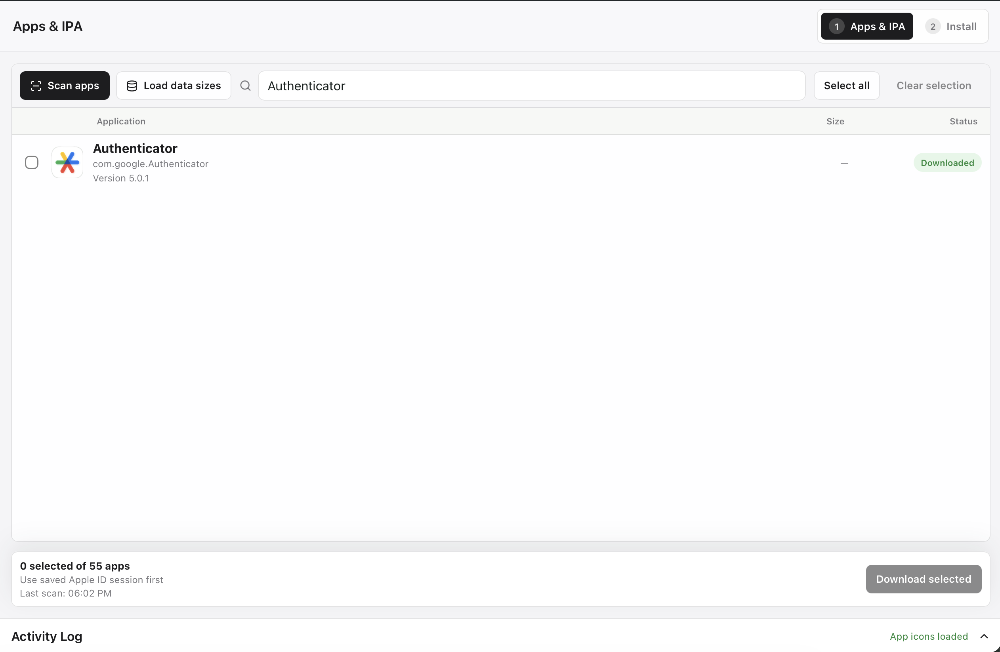

# IPA Shuttle

IPA Shuttle is a macOS GUI application that scans user-installed apps on a
connected iPhone, downloads Apple-provided IPA files for the user's own Apple
ID, and installs local IPA files on another iPhone.

Scan Apps returns names and versions without waiting for iPhone app-data sizes.
The optional data-size query runs only after the user requests it.

It does not extract IPA files from devices, jailbreak, bypass DRM, crack,
patch, re-sign, or share apps. IPA Shuttle is not affiliated with Apple.

## Screenshots

### Apps & IPA



### Install and Activity Log


## Release Build

Prerequisites are macOS 13+, Xcode Command Line Tools, Node.js LTS 24, pnpm 11,
Rust stable, Go 1.26, and Tauri CLI 2. Bundled engines must already exist under
`src-tauri/resources/bin/`.

```bash
pnpm install --frozen-lockfile
pnpm build:dmg
```

Artifacts are written to `src-tauri/target/release/bundle/`. Run the complete
quality gate in [TESTING.md](TESTING.md). Signing and notarization requirements
are documented in [RELEASE.md](RELEASE.md).

TypeScript is intentionally pinned to 6.0.3. TypeScript 7 is not adopted until
the selected stable `typescript-eslint` toolchain supports it without beta,
RC, or compatibility warnings.

## Data and Credentials

- IPA library: `~/Library/Application Support/IPA Shuttle/Library/`
- Icon cache: `~/Library/Application Support/IPA Shuttle/Icons/`
- Manifest: `~/Library/Application Support/IPA Shuttle/manifest.json`
- Logs: `~/Library/Logs/IPA Shuttle/app.log`

Passwords and 2FA codes remain in memory. A remembered auth session uses one
IPA Shuttle-owned Keychain item, `com.ipashuttle.apple-session.v2/active`.
Automatic status checks never read Keychain; `Use saved session` performs the
single explicit read.

Logs are retained for 7 days, rotate at 5 MB with 3 archives, and expose at
most 200 events in the GUI. Clear Logs removes the current and rotated files.

Deleting an IPA removes only that file and its manifest entry from IPA
Shuttle's library. It never uninstalls an app from an iPhone.

## Limits and License

- Apple must still provide the app for the signed-in Apple ID.
- The target iPhone may require the same Apple ID.
- Bundled engines and release artifacts are arm64 only.
- Local release artifacts are ad-hoc signed and not notarized.
- Public distribution requires Developer ID signing and Apple notarization.

The bundled-engine distribution is licensed `GPL-2.0-or-later`. See
[THIRD_PARTY_NOTICES.md](THIRD_PARTY_NOTICES.md), [ARCHITECTURE.md](ARCHITECTURE.md),
[TESTING.md](TESTING.md), and [SECURITY.md](SECURITY.md). Never commit IPA files,
logs, manifests, caches, session data, certificates, or notarization secrets.
