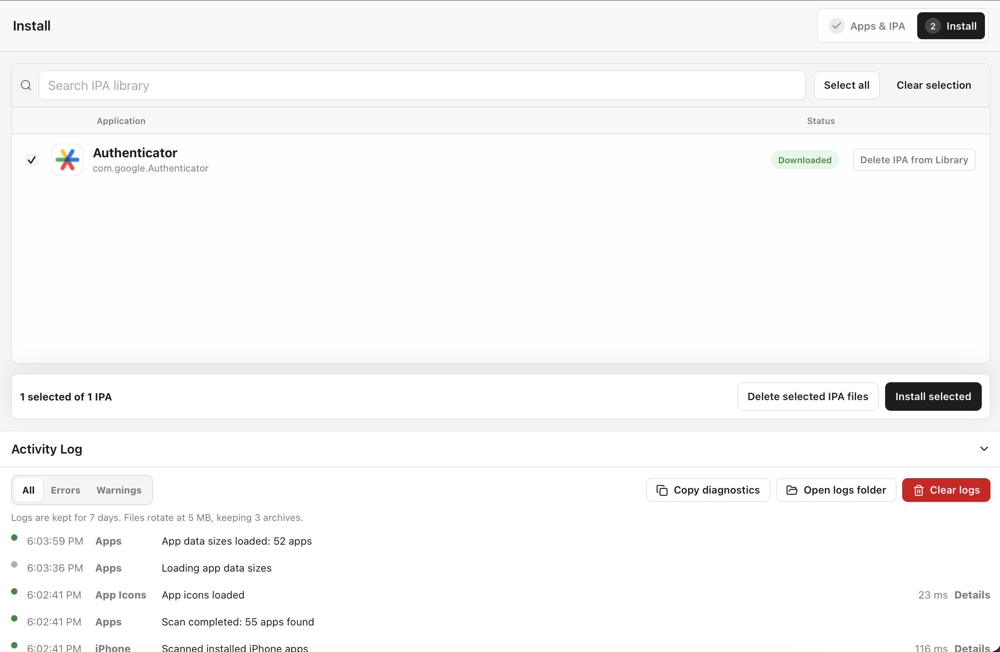

# IPA Shuttle

Приложение для macOS: просматривает установленные на подключённом iPhone приложения, скачивает доступные вашему Apple ID файлы IPA и устанавливает локальные IPA на другой iPhone.

[English](README.en.md) · **[Скачать DMG v0.1.0 для Apple Silicon](https://github.com/vkupyansky/ipa-shuttle/releases/download/v0.1.0/IPA_Shuttle_0.1.0_aarch64.dmg)** · [Описание выпуска и SHA256SUMS](https://github.com/vkupyansky/ipa-shuttle/releases/tag/v0.1.0)

## Возможности

- Список пользовательских приложений с именами и версиями, поиск и сортировка.
- Отдельная загрузка размеров данных по запросу: она не задерживает первоначальное сканирование.
- Вход в Apple ID с двухфакторной проверкой и локальная библиотека IPA.
- Установка IPA на целевой iPhone, общий журнал действий и интерфейс на русском/английском.

### Приложения и IPA


### Установка и журнал действий



## Установка и запуск

Нужны macOS 13 или новее и Mac с Apple Silicon. Готовый выпуск и встроенные движки собраны только для arm64.

1. Скачайте DMG выше, откройте его и перенесите IPA Shuttle в Applications.
2. Запустите приложение. Сборка v0.1.0 подписана локальной ad-hoc подписью и не нотарифицирована. Если macOS блокирует запуск, порядок ручного подтверждения описан в [инструкции Apple](https://support.apple.com/en-sg/102445).
3. Подключите и разблокируйте iPhone, подтвердите доверие этому компьютеру на устройстве.

## Использование

1. Нажмите **Сканировать приложения**. Список появится без ожидания размеров данных; при необходимости отдельно нажмите **Загрузить размеры данных**.
2. Войдите в свой Apple ID и подтвердите двухфакторный вход. Выберите доступные аккаунту приложения и скачайте IPA в локальную библиотеку.
3. Подключите целевой iPhone, перейдите к установке и выберите локальный IPA.

Пароль и коды 2FA остаются в памяти. По желанию вход сохраняется в отдельном элементе Keychain приложения; кнопка **Использовать сохранённую сессию** читает его один раз. Фоновая проверка, сканирование и загрузки Keychain не читают.

IPA хранятся в `~/Library/Application Support/IPA Shuttle/Library/`. Удаление IPA в интерфейсе убирает только файл и его запись из библиотеки, не приложение на iPhone. Журналы находятся в `~/Library/Logs/IPA Shuttle/`, хранятся 7 дней и ротируются по 5 МБ с тремя архивами; интерфейс показывает до 200 событий. Очистка журнала удаляет текущий файл и архивы. Остальные пути описаны в [архитектуре](docs/architecture.md#данные).

## Проверки

Для разработки нужны Xcode Command Line Tools, Node.js 24 LTS, pnpm 11, Rust stable, Go 1.26 и Tauri CLI 2. Движки заранее готовятся в `src-tauri/resources/bin/`; точные зависимости находятся в manifests и lock-файлах.

```bash
pnpm install --frozen-lockfile
pnpm lint
pnpm typecheck
pnpm test
pnpm build
```

Полный набор Rust/Go/coverage/audit-проверок и сценарий на устройствах приведены в [тестировании](docs/testing.md). Сборка DMG выполняется отдельно командой `pnpm build:dmg`; подпись, нотарификация и пути артефактов описаны в [подготовке выпуска](docs/release.md).

## Ограничения

- v0.1.0 является предварительным выпуском.
- Apple должна предоставлять приложение вашему Apple ID; целевому iPhone может потребоваться тот же аккаунт.
- Сохранённые сессии в локально подписанной сборке экспериментальны; вход только в памяти остаётся вариантом по умолчанию.
- Текущая сборка не нотарифицирована. Для распространения с устойчивой Keychain identity нужны Developer ID и нотарификация Apple.
- Это независимый проект, не связанный с Apple. Он не извлекает IPA из установленных приложений, не снимает DRM, не выполняет jailbreak, взлом, переподпись или распространение чужих приложений.

## Документация

- [Архитектура и хранение данных](docs/architecture.md).
- [Тестирование](docs/testing.md), [выпуск](docs/release.md) и [оформление DMG](docs/dmg-artwork.md).
- [Безопасность](SECURITY.md) и [участие в разработке](CONTRIBUTING.md).

## Лицензия

Комплект со встроенными движками распространяется по [GPL-2.0-or-later](LICENSE). Лицензии компонентов и исходный MIT-текст движка ipatool сохранены; подробности в [THIRD_PARTY_NOTICES.md](THIRD_PARTY_NOTICES.md). IPA, учётные данные, кэши, журналы и секреты подписи в репозиторий не входят.
